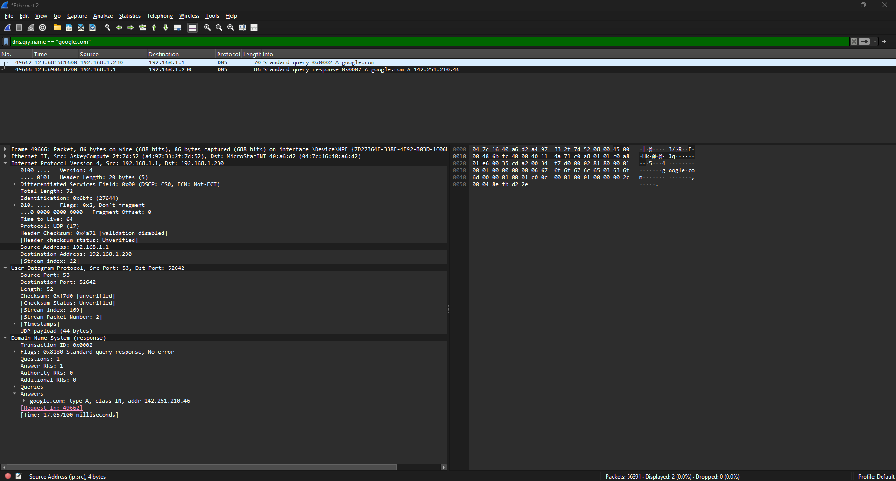
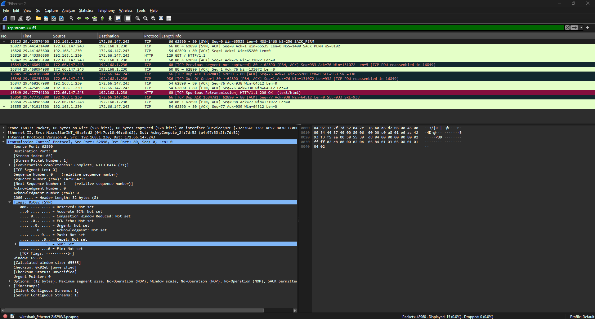
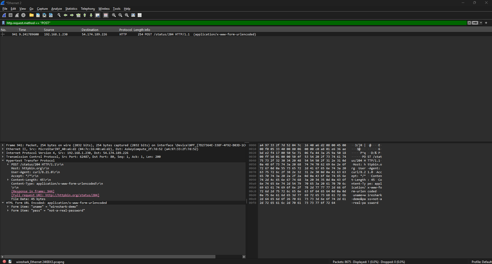
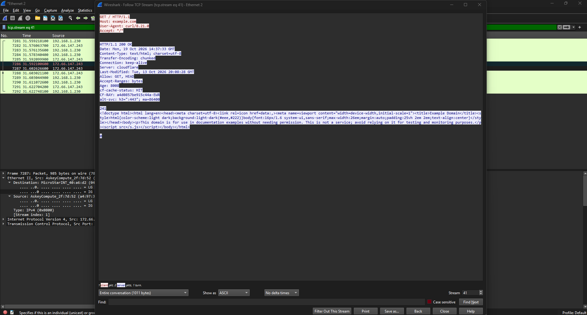
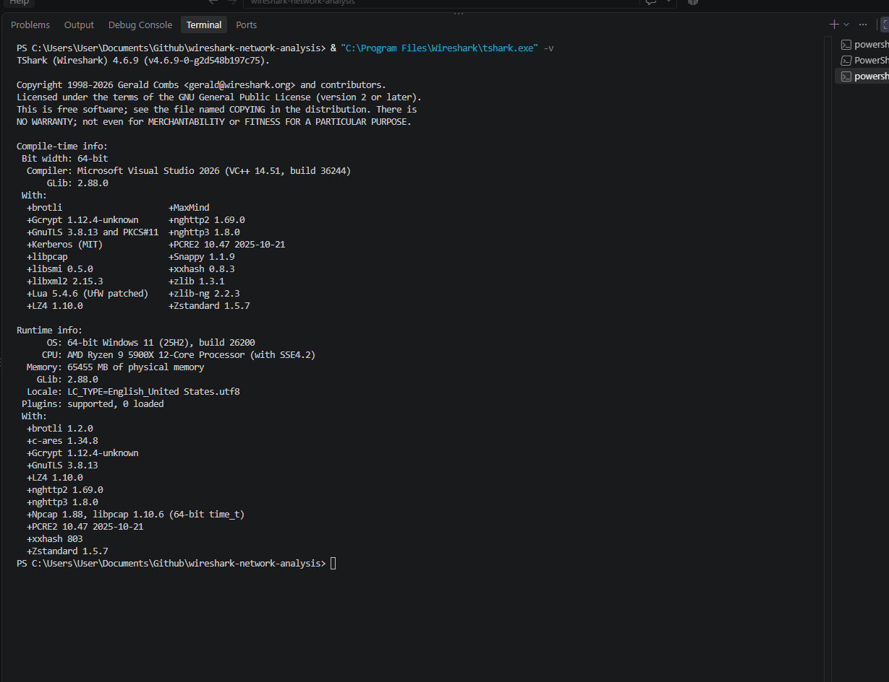
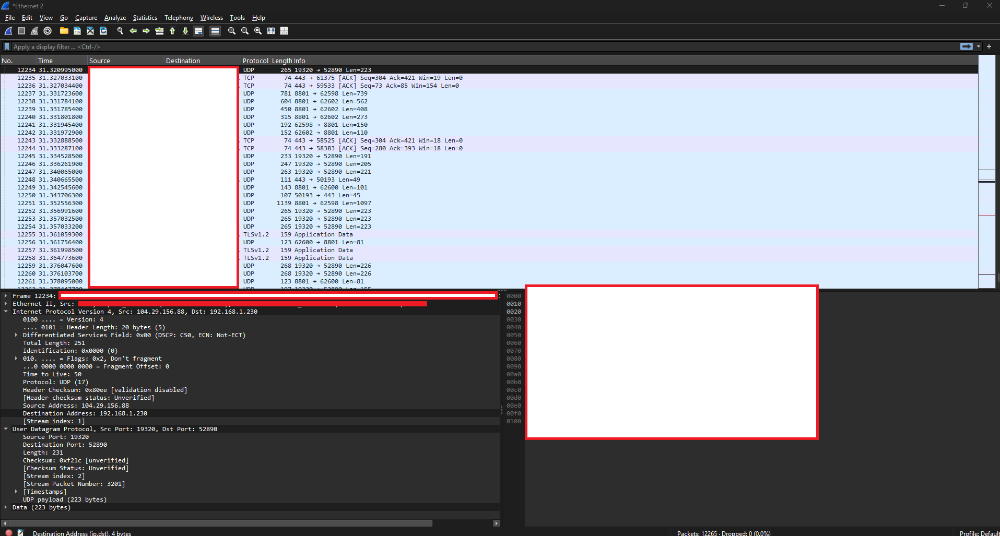
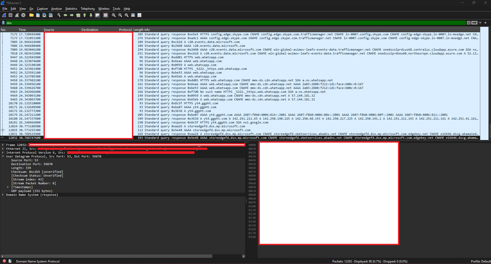
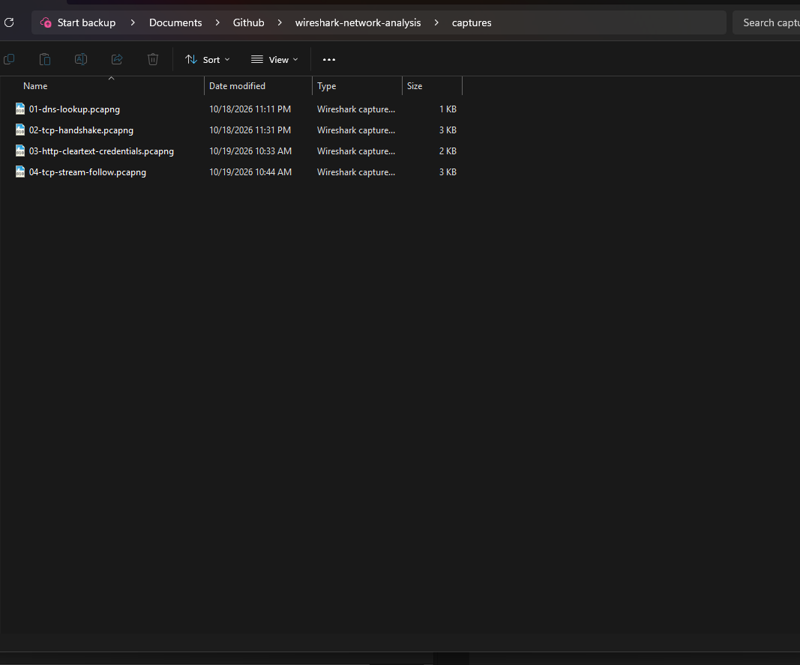
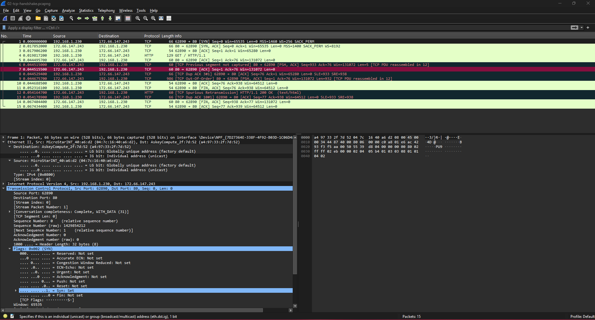

# Wireshark Network Analysis — Lab 2

I captured and inspected DNS, TCP, and HTTP traffic on my Windows computer to practice troubleshooting at the packet level. I paired a DNS query with its response, identified a TCP three-way handshake, demonstrated fake credentials traveling over plain HTTP, and reconstructed an HTTP conversation.

This is Lab 2 of my five-lab IT portfolio. My [Active Directory domain lab](https://github.com/ThomasTafa29/active-directory-domain-lab) covers the environment I built in Lab 1.

**Video walkthrough:** Pending recording.

## Results

I exported four focused captures, reopened each file in Wireshark, and reviewed their contents with TShark.

| Exercise | Capture | Packets | What I verified |
|---|---|---:|---|
| A — DNS | [01-dns-lookup.pcapng](captures/01-dns-lookup.pcapng) | 2 | A query and response for `google.com`, sharing transaction ID `0x0002`; the response returned `142.251.210.46`. |
| B — TCP handshake | [02-tcp-handshake.pcapng](captures/02-tcp-handshake.pcapng) | 15 | The first three packets show SYN, SYN/ACK, and ACK, followed by an HTTP request and a `200 OK` response. |
| C — Cleartext form data | [03-http-cleartext-credentials.pcapng](captures/03-http-cleartext-credentials.pcapng) | 10 | An HTTP POST exposes the deliberately fake `uname` and `pass` values; the server returns `204 No Content`. |
| D — Stream reconstruction | [04-tcp-stream-follow.pcapng](captures/04-tcp-stream-follow.pcapng) | 12 | Follow TCP Stream reconstructs a GET request, HTTP headers, and the Example Domain page returned with `200 OK`. |

## Environment

| Component | Used in this lab |
|---|---|
| Operating system | Windows 11 |
| Packet tools | Wireshark and TShark 4.6.9 |
| Capture driver | Npcap 1.88 |
| Editor and shell | VS Code and PowerShell |
| Traffic generators | `nslookup` and `curl.exe` |
| Active capture adapter | Ethernet 2 |
| Local IPv4 address | `192.168.1.230` |
| Router / DNS server used | `192.168.1.1` |

These addresses and DNS answers describe my capture session. They may differ on another computer or at another time.

## Capture workflow and display filters

For each exercise, I started a capture on Ethernet 2, generated the intended traffic in PowerShell, stopped the capture, and filtered it to the relevant exchange. I used **File → Export Specified Packets → Displayed** to save the selected packets, then reopened the exported file to verify it.

My first practice capture contained **12,265 packets**, with **0 reported drops**. Applying `dns` displayed **90 packets (0.7%)**. This showed why filtering is necessary even during a short capture.

| Display filter | Purpose |
|---|---|
| `dns` | Show DNS queries and responses. |
| `http` | Show traffic decoded as HTTP. |
| `tcp` | Show TCP traffic, including connections carrying encrypted application data. |
| `tcp.flags.syn == 1` | Find packets with SYN set, including SYN/ACK packets and retransmitted SYNs. |
| `tcp.flags.reset == 1` | Find TCP resets; the flag alone does not explain their cause. |
| `icmp` | Show ICMP for IPv4; ICMPv6 uses the separate `icmpv6` filter. |
| `ip.addr == 8.8.8.8` | Match an IPv4 address as either source or destination. |
| `ip.src == 192.168.1.230` | Match packets sent from my local IPv4 address. |
| `tcp.port == 443` | Match TCP traffic with source or destination port 443. |
| `http.request` | Show decoded HTTP requests. |

A display filter changes which captured packets are visible. It does not remove packets from the original capture. A filter with zero matches does not establish that the network is broken.

## Exercise A — DNS lookup

I requested an IPv4 answer from my router's DNS service:

```powershell
nslookup -type=A google.com. 192.168.1.1
```

I narrowed the capture with `dns.qry.name == "google.com"` and exported the query and response. Both used transaction ID `0x0002`. The response's Answers section contained the A record `142.251.210.46`.

In the verification output, the DNS response flag is `False` for the query and `True` for the response. These values identify the message type; they are not test results.



## Exercise B — TCP three-way handshake

I generated a plain HTTP connection:

```powershell
curl.exe -4 -v --connect-timeout 10 --max-time 20 http://example.com/
```

The captured connection ran from `192.168.1.230:62890` to `172.66.147.243:80`. After selecting that conversation, I exported its 15 captured packets.

| Packet in the exported file | Direction | Flags | Relative sequence values |
|---|---|---|---|
| 1 | Client → server | SYN | Seq 0 |
| 2 | Server → client | SYN/ACK | Seq 0, Ack 1 |
| 3 | Client → server | ACK | Seq 1, Ack 1 |

I expanded the first packet's TCP Flags field to confirm that SYN was set. The subsequent GET and `200 OK` response showed that this connection carried application traffic after the handshake.

Wireshark also marked some later packets with TCP analysis warnings. I did not determine their cause. The handshake is visible, but I do not treat this file as proof of a loss-free capture.



## Exercise C — Cleartext HTTP form data

I sent deliberately fake username and password fields to an HTTP endpoint:

```powershell
curl.exe -4 -v --connect-timeout 10 --max-time 20 -d "uname=wireshark-demo&pass=not-a-real-password" http://httpbin.org/status/204
```

Filtering with `http.request.method == "POST"` located the request. Expanding the URL-encoded form data exposed both values:

| Field | Deliberately fake value |
|---|---|
| `uname` | `wireshark-demo` |
| `pass` | `not-a-real-password` |

The server returned **204 No Content**, which was expected for this endpoint. This demonstrated readable form data in transit; it was not a successful login or a test of an authentication system. URL encoding did not encrypt the values.

I then selected the associated TCP conversation and exported its 10 captured packets, retaining the handshake and response along with the POST. HTTPS protects HTTP contents in transit using TLS; plain HTTP does not provide that protection.



## Exercise D — Follow TCP Stream

I made another HTTP request to `example.com` using the Exercise B command. I selected its GET packet and opened **Follow → TCP Stream**, using ASCII and the entire conversation.

The reconstructed stream showed `GET / HTTP/1.1`, `Host: example.com`, the server's `200 OK` response, and the Example Domain HTML. The original capture used stream 41; the exported 12-packet file uses stream 0. Stream numbers are local to a capture file.

The Follow TCP Stream window's counts describe data-bearing packets in the selected conversation; they are not the exported file's total packet count.



## Command-line capture and verification

I used `tshark -D` to identify Ethernet 2 as interface **2** for this session, then captured **200 packets** into a temporary file outside the repository. I read back the first ten packets using packet number, protocol, and frame length fields to keep the supporting screenshot focused on the command-line workflow.

The scripts are organized by purpose:

| Script | How to use it |
|---|---|
| [01-generate-lab-traffic.ps1](scripts/01-generate-lab-traffic.ps1) | Run the individual exercise command while capturing that exercise. |
| [02-tshark-cli-capture.ps1](scripts/02-tshark-cli-capture.ps1) | Run line by line, confirming the interface number from `-D` before capturing. The script includes a temporary-file cleanup command. |
| [03-verify-captures.ps1](scripts/03-verify-captures.ps1) | Run as a whole file from the project root after all four captures exist. |

```powershell
& .\scripts\03-verify-captures.ps1
```

The verification script checks that the expected files exist, prints packet counts and address/hostname metadata, displays the DNS fields and handshake, extracts the fake form values, and reconstructs the saved HTTP stream. I reviewed its output manually. It is not an automated pass/fail test or a complete privacy audit.

## Troubleshooting and changes to the instructions

| Issue | What I observed or accounted for | What I changed |
|---|---|---|
| Original HTTP test host did not connect | A request to `testphp.vulnweb.com` timed out; its capture showed SYN retries without a SYN/ACK. The cause was not established. | Used `example.com` for the handshake and stream exercises, and `httpbin.org/status/204` for the fake form POST. |
| Browser-generated traffic can differ from the intended HTTP exercise | Browsers can upgrade requests to HTTPS, which changes the visible application traffic. | Used explicit `http://` URLs with `curl.exe -4`, with connection and overall time limits. |
| Windows executable invocation and interface selection | An unqualified executable may not be on PATH, and the Linux name `eth0` does not identify my Windows adapter. | Used the full TShark path with PowerShell's `&` operator and selected the interface returned by `-D`. |
| Localhost traffic uses a different capture path | A localhost form would not traverse the Ethernet 2 adapter used for these exercises. | Generated an over-the-network POST containing only fake values. |
| TShark interface variable was not initialized | Editing `$iface` in a script did not execute that assignment in the terminal session. | Ran `$iface = 2` in the same PowerShell session before retrying the capture successfully. |
| Filter still referenced an old stream after reopening | Stream numbering changed in the exported file; editing the filter text also required applying the change. | Cleared and applied the filter, then verified all exported packets and the new stream number. |

## Evidence gallery

The exercise screenshots above document DNS, the handshake, the fake form values, and stream reconstruction. The remaining main screenshots document installation, initial capture, filtering, file management, and reopening a capture.

### Installation



### First capture



### Display filtering



### Saved captures



### Reopening and verification



Supporting evidence:

- [TShark command-line capture and readback](screenshots/supporting/08a-tshark-cli-capture.png)
- [Four capture counts, DNS, handshake, and fake form verification](screenshots/supporting/09a-capture-verification.png)
- [Reconstructed stream verification output](screenshots/supporting/09b-stream-verification.png)

## Privacy and scope

The four exercise exports are kept separately from the broad practice capture. Screenshots 02 and 03 have opaque redactions over network identifiers and packet bytes. Unredacted screenshot originals are kept in the ignored `screenshots/archive/` folder. The broad practice capture and temporary CLI capture are not portfolio deliverables.

Only fake form values were used. Exporting a filtered conversation limits unrelated packets, but it does not anonymize MAC addresses, interface metadata, or application contents within that conversation. Screenshot redactions do not alter the underlying capture files.

I performed these exercises on my own computer and generated the test traffic myself. The captures demonstrate the recorded exchanges; they do not establish the causes of every TCP warning or timeout.

## What I learned

- Pair DNS messages using the transaction ID and inspect the returned answer.
- Read TCP flags and relative sequence numbers to explain connection establishment.
- Distinguish a visible HTTP payload from encrypted application traffic.
- Reconstruct a request and response across packets using Follow TCP Stream.
- Export the intended conversation, reopen the saved file, and verify its contents.
- Use command-line packet tools and document changes when an exercise does not behave as expected.

These skills support cloud and IT troubleshooting by helping separate name-resolution, connection-establishment, and application-response problems. Flow logs can complement packet analysis, but they do not provide the same application payload detail shown here.
